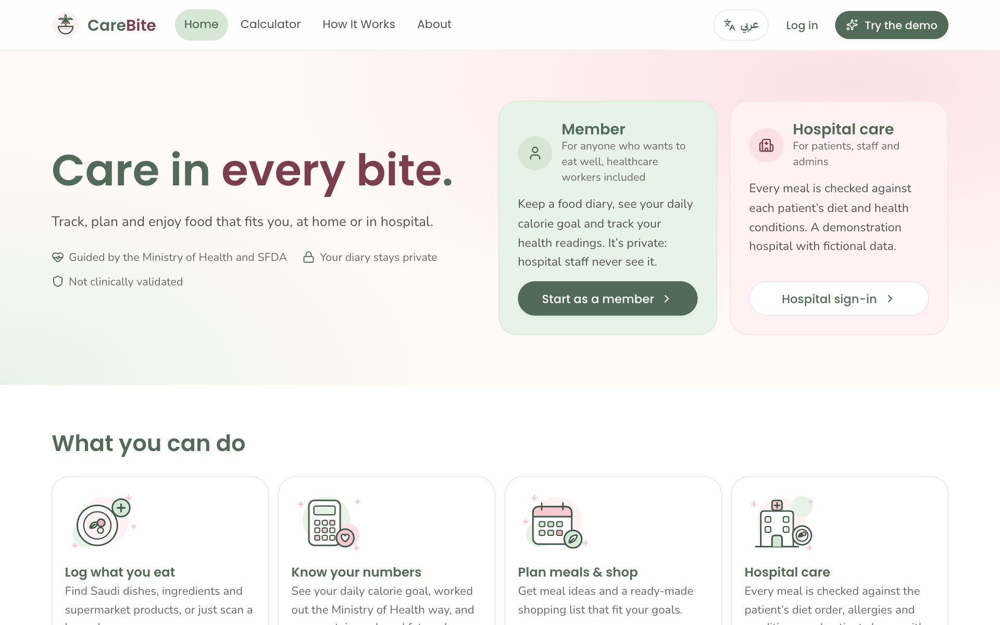
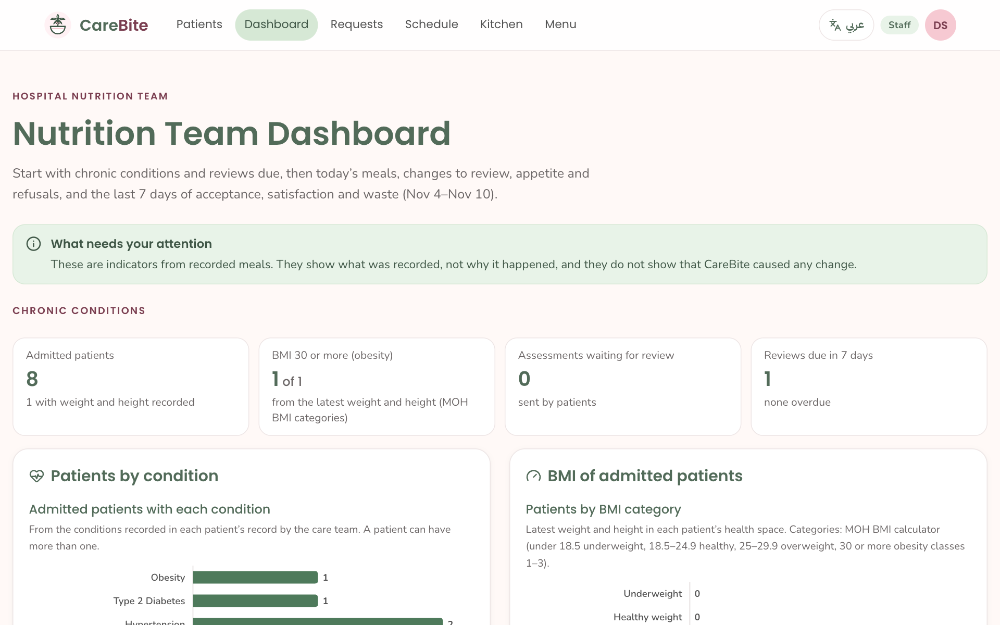
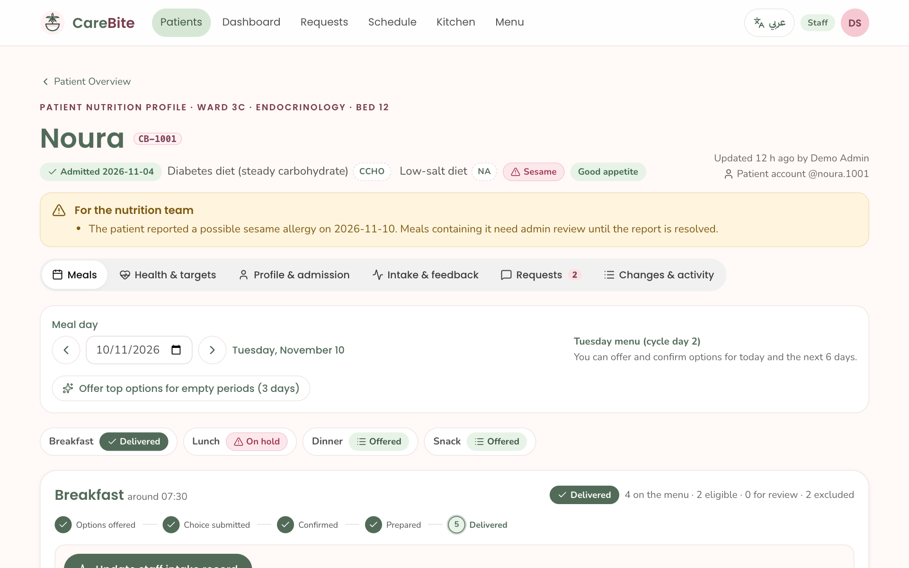

# Wastelimiting · CareBite

**CareBite** supports healthy eating for **obesity and chronic diseases** (obesity, type 2 diabetes, high blood pressure, heart and kidney disease). It is a university Health Informatics project with two spaces:

- **Member** — anyone, including healthcare workers, managing their own lifestyle: a food diary with calories and macros for Saudi dishes, single ingredients and supermarket products (search, grams, barcode), the MOH BMI and calorie calculator, personal targets, weight / blood pressure / blood sugar readings, an optional assessment, meal ideas and an MOH meal plan with a shopping list. **Private: no hospital role can see it.**
- **Hospital care** — patients, staff and admins: meals screened against each patient's diet order, conditions and allergies, followed from the offer to the tray; a care-team assessment with daily targets and review dates; and a home plan at discharge. Recording plate waste is kept as a secondary benefit (less food wasted).

Every food value and health rule cites its source, **Saudi government first**: the Ministry of Health (calorie and BMI calculators, the Calorie Guide for Weight Loss, the obesity guideline, salt and diabetes advice), the Saudi National Diabetes Center, the Saudi Food & Drug Authority (Saudi Food Composition Tables, allergens), MEWA and GFSA. Non-Saudi sources are used only where no Saudi one exists, and are labelled (USDA FoodData Central for single ingredients, Open Food Facts for packaged products, IDDSI for textures).

**Designed and developed by:** Lana Fahad Alhari (لانا فهد الحريّ)

> **Medical disclaimer.** CareBite is an educational Health Informatics project designed to demonstrate personalized nutritional decision support. It does not diagnose medical conditions, replace professional medical advice, or guarantee clinical outcomes. Meal suggestions depend on the available data and reviewed dietary rules. Users with complex medical conditions, prescribed diets, or uncertain allergy information should consult a qualified healthcare professional.

All patients, staff and records in this project are fictional (synthetic demonstration data).

<p align="center">
  
</p>

<p align="center">
  
  
  
</p>

---

## Why: obesity and chronic diseases

MOH reports that about 20% of adults in Saudi Arabia live with obesity (MOH national survey, 2019, cited in the MOH Calorie Guide for Weight Loss), and obesity raises the risk of type 2 diabetes, high blood pressure and heart disease. CareBite helps people eat to a target they understand:

1. **Know your numbers.** BMI, MOH waist risk levels and daily energy needs with the MOH method (Mifflin-St Jeor × activity).
2. **Track what you eat.** Calories, carbohydrate, protein, fat, sugar and sodium for every food, with the source of each value.
3. **Follow a plan.** MOH meal plans from 1,200 to 2,200 kcal, the MOH exchange list for swaps, and a printable shopping list.
4. **In hospital,** meals are checked against every condition and allergy together, the care team reviews the assessment and sets targets, and the patient leaves with a home plan.

## Less food waste (secondary)

Hospital meals that do not fit a patient (wrong diet, an allergen, a disliked food, too large a portion for a poor appetite) are refused or left on the plate. CareBite addresses this at each step:

1. **Screening first.** Meals that conflict with the diet order or allergies are excluded before anything is offered, and meals with incomplete information go to an admin for review. Preferences never bring back an excluded meal.
2. **Choice within safe options.** Patients choose from approved options on their phone. Ranking uses their preferences, past feedback and appetite.
3. **Right-sized portions.** Portions are suggested from the patient's appetite and the portions their diet order permits.
4. **Only confirmed meals reach the kitchen.** The kitchen prepares exact quantities by meal and portion. Changes after confirmation (a new allergy, an unavailable meal, a menu edit) put the order on hold, so nothing unsuitable is cooked or delivered.
5. **Measured outcomes.** Acceptance, the estimated amount eaten, satisfaction and **weighed plate waste (grams)** are recorded separately and shown on the team dashboard. This follows the GFSA National Program to Reduce Food Loss and Waste.

<p align="center">
  
</p>

## Features by role

Hospital care has three roles; the member space has one. Every action is authorized by role-based access control (RBAC).

| Role | What they do |
| --- | --- |
| **Member** | **Today**: food diary by meal, search (MOH portions, SFDA Saudi dishes, ingredients, supermarket products), grams or household portions, barcode, quick add and "add from a pack label". **My Health**: BMI, waist risk, daily needs, personal targets, readings with history, the optional assessment. **Meal Ideas** and **My Plan** (MOH meal plan, exchanges, shopping list, healthy habits). |
| **Patient** | **Today** and **My Health** (as members, but targets come from the care team and hospital meals eaten count automatically). **My Meals**: the next meal and what to do next, approved options with "Why this meal?", choosing a meal, the day and week view, and feedback after delivery. **My Requests**: requests and the team's responses. **My Food Profile**: preferences and appetite, and reporting a diet or allergy change for review. |
| **Staff** | **Health tab** for each patient (readings, targets, assessment), the chronic-conditions dashboard section. **Patient overview** and nutrition profiles. Offering and confirming eligible meals, recording a patient's choice, cancelling and handling held meals. **Kitchen summary**: quantities, tray tickets, prepared → delivered, and change alerts. Also the meal schedule, recording intake (including weighed waste), editing the menu, answering requests, and admission and discharge. |
| **Admin** | Everything staff can do, plus reviewing assessments and setting nutrition targets, and: clinical information (diet orders, allergies, restrictions), approving meals that need review, verifying menu dietary information, creating and deleting records, and approving staff access and assigning roles. |

The meal workflow is **Options offered → Patient choice submitted → Confirmed by nutrition team → Prepared → Delivered**. Delivered does not mean eaten: intake is recorded separately.

<p align="center">
  
</p>

## Tech stack

- **Next.js 16** (App Router, React 19, TypeScript). Pages are server components; client components use **SWR**, starting from the server-fetched data.
- **better-auth**: email or username with a password and **server-side sessions**. No JWT, and no external auth provider.
- **Postgres** ([Neon](https://neon.tech) in production) through `pg`, shared by the domain and better-auth. Each request reads one consistent snapshot of the data; every change is saved in one transaction under a write lock, so several server instances can share the database safely.
- **Tailwind CSS v4** with **shadcn-style components** on **Base UI**, using the CareBite palette.
- **Motion** from [transitions.dev](https://transitions.dev) CSS transitions, installed with its CLI (`npx transitions-dev add --free`).
- The **domain layer** (`domain/`) is plain JavaScript and holds the screening engine, the meal workflow, menu management and RBAC.

## Getting started

Requirements: **Node.js 22 or newer** and a **Postgres database**: a free [Neon](https://neon.tech) database (a development branch works well), or Postgres installed locally.

```bash
git clone https://github.com/lanafahad1/Wastelimiting.git
cd Wastelimiting
npm install
cp .env.example .env.local
# edit .env.local:
#   BETTER_AUTH_SECRET  a random value of at least 32 characters (openssl rand -base64 32)
#   DATABASE_URL        your Postgres connection string
npm run dev            # http://localhost:3000
```

On first start the tables are created in that database and seeded with:
- the hospital menu;
- the SFDA Saudi Food Composition Tables (130 dishes);
- the diet rules;
- the demo accounts;
- a fictional demonstration hospital with 10 patients and 6 days of history.

| Command | What it does |
| --- | --- |
| `npm run dev` | Development server. |
| `npm run build` then `npm start` | Production build and server. |
| `npm test` | Domain, RBAC and password-policy tests (34). The 8 Postgres tests also run when `TEST_DATABASE_URL` points to a disposable database (its tables are dropped). |
| `npm run test:e2e` | Cross-role browser test, 64 checks. Run it against a freshly seeded server; set `CHROMIUM=/path/to/chrome` if Playwright's browser is not installed. |
| `npm run typecheck` | TypeScript check. |
| `npm run reset-db -- --yes` | Delete every CareBite table in the `DATABASE_URL` database; the next start creates and seeds them again. To reset only the demonstration hospital, sign in as `admin.demo` and use the reset in Settings. |

### Account emails (optional)

Email confirmation and "Forgot password?" emails are sent through Gmail with an app password. Set `GMAIL_USER`, `GMAIL_APP_PASSWORD` (and optionally `EMAIL_FROM_NAME`) in `.env.local` or in Vercel → Settings → Environment Variables (see `.env.example`). Recipients see **CareBite &lt;GMAIL_USER&gt;**. Without these settings no email is sent: the reset page says it isn't set up, and in development the link is printed in the server log. Demo accounts never receive emails and can't be reset.

### Demo accounts (demonstration access only)

All demo accounts use the password `CareBite#2026`, and the login page has one-click buttons. **No identity is verified**: these are shared demonstration accounts, not real credentials.

| Username | Role |
| --- | --- |
| `admin.demo` | Admin |
| `staff.demo` | Staff |
| `noura.1001`, `khalid.1004` | Patients CB-1001 and CB-1004 |
| `sara.member` | Member (personal use, no hospital) |

`layla.applicant` is a pending staff access request that `admin.demo` can approve.

### Deploying on Vercel with Neon

1. Import the GitHub repository in Vercel.
2. In the project, open **Storage → Create Database → Neon** and connect it to the project. This adds `DATABASE_URL` to the project's environment variables. Choose a Neon region close to your Vercel functions' region (Vercel's default is Washington, D.C., so AWS US East 1).
3. In **Settings → Environment Variables**, add `BETTER_AUTH_SECRET` (a new random value) and `BETTER_AUTH_URL` (the site's address, for example `https://your-app.vercel.app`), and optionally the `ADMIN_…` variables below.
4. Deploy. The first request creates the tables and seeds the demonstration data.

Data now persists across deployments and server instances. The free Neon plan pauses the database when idle, so the first request after a quiet period can take a few seconds.

### Your own admin account

The `admin.demo` password is published, so on a deployed site anyone can use it. To have an admin account only you can sign in to, set these in `.env.local`, or in your host's environment variables:

```bash
ADMIN_USERNAME=your.username      # 3–20 letters, numbers, dots or underscores, starting with a letter
ADMIN_EMAIL=you@example.com
ADMIN_PASSWORD=a long private passphrase
ADMIN_NAME=Your Name              # optional
```

- The account is created at start-up if it does not exist yet. The server refuses to start if one of the three required values is missing, or if the password breaks the sign-up password rules.
- An existing account is never changed: to change the password, use Settings.
- If the database is reset, the account is created again from these values.

## Project structure

```
app/                 Next.js routes (server components), API route handlers, sitemap, robots, OG image
  api/auth/[...all]  better-auth endpoints
  api/[...path]      JSON API for client components (SWR reads and mutations)
  styles/            transitions.dev snippets used by the app
components/
  ui/                shadcn-style primitives on Base UI, wired to the transitions
  cb/                status chips, workflow stepper, diet code toggletips, meal rows, "Why This Meal?"
  forms/             patient profile sections, intake fields, ingredient pickers
  site/, public/, auth/, patient/, patients/, staff/   per-area components
domain/              screening engine, workflow, menu management, RBAC policy, Postgres store
data/                SFDA SFCT dish values, ingredients, dishes, meals, menu cycle, local production
lib/                 auth configuration, session to actor, API client, SEO, formatting
proxy.ts             per-request CSP nonce, security headers, sign-in redirect
docs/                contributor conventions and screenshots
test/, e2e/          node:test suites and the cross-role browser test
```

## Security and privacy

- **Sessions.**
  - Sessions are stored on the server. The browser holds only an opaque cookie: `HttpOnly`, `SameSite=Lax`, `Secure` over HTTPS.
  - The lifetime is 8 hours, sliding.
  - Sessions are revoked on password change, deactivation and account deletion.
  - Session tokens are never included in JSON responses.
- **Passwords** follow OWASP and NIST guidance:
  - at least 8 characters, with no composition rules;
  - common passwords are refused, as is a password equal to the username or email;
  - hashed with scrypt.
- **Rate limits.**
  - Sign-in allows 5 attempts per minute per IP; sign-up, password change and account deletion allow 5 per 5 minutes.
  - Sign-in gives one generic error message.
  - Limits are counted in the database, so they hold across server instances.
  - Limits use the forwarded client IP, so deploy behind a reverse proxy that sets `X-Forwarded-For` (Vercel does).
- **No privilege escalation.** Role, status and the patient link are server-only fields. A staff sign-up is only a request until an admin approves it. Patients join with a one-time link code from the nutrition team.
- **RBAC.**
  - A single policy (`domain/rbac.js`) is checked by pages, the API and every domain operation.
  - Protected areas return a real HTTP 403 to roles without access.
- **CSRF and headers.**
  - Same-origin checks, plus a custom header on API mutations.
  - A strict Content-Security-Policy with a per-request nonce.
  - `X-Frame-Options: DENY`, `nosniff`, `Referrer-Policy`, `Permissions-Policy`, and HSTS in production.
- **Data protection.**
  - Private pages are server-rendered after the permission check, and marked `noindex`.
  - Every change is written to an audit log.
  - No secrets are committed: configuration lives in `.env.local` (or the host's environment variables), which git ignores; see `.env.example`.

## Data sources

- **Food values, in this order of preference:**
  1. **MOH Calorie Guide for Weight Loss** — the food exchange list (calories and macros per MOH portion) and meal plans from 1,200 to 2,200 kcal.
  2. **SFDA Saudi Food Composition Tables (SFCT)**, first edition — laboratory values for 130 traditional Saudi dishes (all searchable; 18 hospital dishes are prepared to SFCT recipes). 9 internally inconsistent tables are kept as published and cannot be linked.
  3. **USDA FoodData Central (SR Legacy)** — per-100 g values for 140 single ingredients; international recipes are calculated from their ingredient weights and labelled "calculated".
  4. **Open Food Facts** — 600 supermarket products sold in Saudi Arabia (community data, ODbL; "check the pack label"), plus products people add from their own pack labels.
  - Missing values are never estimated; meals a rule cannot check go to admin review.
- **Calculator:** the MOH calorie and BMI calculators (Mifflin-St Jeor × activity factor; MOH BMI categories) and MOH waist risk levels.
- **Rules:**
  - MOH salt limit (5 g a day), diabetes, kidney disease and gluten-free guidance;
  - the Saudi Diabetes Clinical Practice Guidelines;
  - SFDA's 14 declarable allergens and its "high in fibre" level.
- **Other:**
  - local production figures from MEWA and GASTAT;
  - the GFSA food-waste programme;
  - IDDSI texture levels (no Saudi standard was found).

The full list of sources is on the site's **Data sources & limitations** page.

## Limitations

- **Not production-ready:**
  - no real identity verification (email confirmation is a reminder only; account emails need the optional Gmail settings below);
  - no notifications outside the app;
  - no connection to hospital systems (EHR, admission, pharmacy).
- **Not clinically validated.** The rules follow cited Saudi guidance but have not been validated; a hospital dietetics department would need to review them.
- **Readings are not interpreted.** Blood pressure and blood sugar are a history only; CareBite gives no alerts or medical advice.
- **Targets are not prescriptions.** Members' targets are personal estimates; patients' targets come from the care team.
- **Data gaps:**
  - USDA and Open Food Facts values are not Saudi laboratory values; packaged-product allergens come from community tags and must be checked on the label;
  - barcode scanning with the camera works only in browsers with the BarcodeDetector API (typing the number works everywhere);
  - menu items have no texture levels;
  - dashboard figures describe recorded meals only and do not show cause and effect.

## Acknowledgements

- [SFDA Saudi Food Composition Tables](https://www.sfda.gov.sa/en/news/19089) and the [MOH Calorie Guide for Weight Loss](https://www.moh.gov.sa/HealthAwareness/EducationalContent/Food-and-Nutrition/Documents/Food-Calorie-Calculator.pdf).
- [USDA FoodData Central](https://fdc.nal.usda.gov/) (public domain) and [Open Food Facts](https://world.openfoodfacts.org) (contains data from Open Food Facts, © Open Food Facts contributors, under the [ODbL](https://opendatacommons.org/licenses/odbl/1-0/)).
- [transitions.dev](https://transitions.dev) CSS transitions, used under its terms (the library itself is not redistributed here).
- [Base UI](https://base-ui.com), [shadcn/ui](https://ui.shadcn.com) patterns, [better-auth](https://www.better-auth.com), [Next.js](https://nextjs.org), [SWR](https://swr.vercel.app) and [Tailwind CSS](https://tailwindcss.com).
